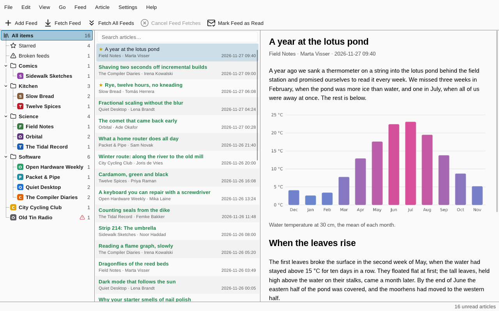
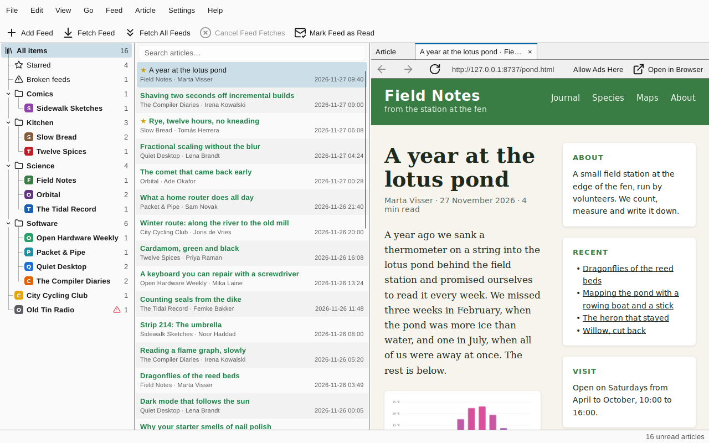

<!--
SPDX-FileCopyrightText: Copyright 2026  Heinz Wiesinger, Amsterdam, The Netherlands
SPDX-License-Identifier: GPL-3.0-or-later
-->

<p align="center">
  
</p>

<h1 align="center">Ren</h1>

<p align="center">
  A native, lightweight desktop reader for
  <a href="https://apps.nextcloud.com/apps/news">Nextcloud News</a>
</p>

<p align="center">
  <a href="https://github.com/pprkut/ren/releases"></a>
  <a href="https://github.com/pprkut/ren/actions/workflows/general.yml"></a>
  <a href="https://github.com/pprkut/ren/actions/workflows/code-tests.yml"></a>
  <a href="https://github.com/pprkut/ren/actions/workflows/full-tests.yml"></a>
  <a href="https://codecov.io/gh/pprkut/ren"></a>
  <a href="LICENSES/GPL-3.0-or-later.txt"></a>
  
</p>

<picture>
  <source media="(prefers-color-scheme: dark)" srcset="docs/screenshots/main-dark.webp">
  
</picture>

Ren syncs the feeds, folders and articles of your Nextcloud, and whether
you read or starred them, and works from its own copy, also offline.
Articles are shown as the feed sends them; the web page behind an
article opens in a tab, rendered by Servo, with ads and trackers
blocked. Written in Rust, with low memory and processor use first.

蓮 (*ren*) is the lotus of its logo.

## Features

- **Offline first.** Everything is read from a local database; syncs
  are incremental, in the background and at a low priority. Read and
  starred marks made offline go to the server with the next sync.
- **Articles as the feed sends them**, with their images, light or dark.
  Images are cached on disk, or loaded only when you ask, so sites don't
  learn what you read.
- **Web pages in tabs**, rendered by [Servo](https://servo.org) in a
  helper program that only starts with the first tab. Ads and trackers
  are blocked by EasyList, EasyPrivacy and uBlock's lists, and sites can
  be let off.
- **Feeds and folders managed from Ren:** add feeds (also from a site's
  address), rename, move and delete feeds and folders. Feeds the server
  can't update are marked, with the reason.
- **Keyboard first:** shortcuts for reading and for the menus' actions,
  which the menus list. Find text in the article or page, and search the article list.
- **At home on the desktop:** logs in through the browser (two-factor
  authentication and single sign-on work), keeps the app password in the
  Secret Service (KWallet, GNOME Keyring), sits in the system tray with
  the number of unread articles, and follows the light or dark colour
  scheme.
- **Small:** the window takes about 50 MiB at idle, also with tens of
  thousands of articles synced, and no processor time
  ([`docs/performance.md`](docs/performance.md) has the numbers).



## Requirements

- Linux, on X11 or Wayland.
- A Nextcloud with the [News app](https://apps.nextcloud.com/apps/news)
  (its API v1-3; tested with News 28.7 on Nextcloud 32 and News 29.0 on
  Nextcloud 33).
- For the app password, a Secret Service (KWallet, GNOME Keyring) or a
  command that prints it, such as `pass`.

## Getting started

Start `ren`. The first time, it asks you to log in to your Nextcloud in
the browser (this makes an app password of its own, which your Nextcloud
lists under Security), or to enter an app password you made yourself.
The first sync then brings in your feeds and articles.

The shortcuts for reading:

| Key | |
|-----|---|
| J, K | next and previous article |
| Space | scroll the article |
| M | mark read or unread |
| S | star or unstar |
| O | open the article's page in a tab |
| Ctrl+F | find text in the article or page |
| Alt+Q | search the article list |
| F5, Ctrl+L | fetch the feed, all feeds |

Settings → Configure Ren… has the settings, which are kept in
`~/.config/ren/settings.toml`, a file you may also edit by hand
([`docs/settings.md`](docs/settings.md) lists them all). Instead of the
Secret Service, the app password can come from a command
(`password-command`, e.g. `pass show nextcloud/ren`).

## Installing

There are no packages yet; Ren is built from source. It needs Rust 1.92
or newer and the fontconfig development files; the web page tabs need
what Servo needs to build (clang, Python 3, and for SpiderMonkey a C++
compiler; see [Servo's
documentation](https://book.servo.org/)). With
[just](https://just.systems):

```sh
just build                 # ren and its Servo helper, in target/release
sudo just install          # into /usr/local
```

`just install` takes the variables of COSMIC's justfiles: `just
prefix="$HOME/.local" install` for yourself, `just prefix=/usr
rootdir="$PKG" install` for packages (and `docdir=…` if the
documentation goes elsewhere); `just uninstall` with the same
variables removes it again.

The Servo helper (`ren-servo`) is a program of its own, in a workspace of
its own (`crates/ren-servo`): Servo and Ren's article view can't share a
build. It's installed into `libexec/ren/` and only started when a web page
opens. Without it, pages open in the browser; `cargo build --release`
alone builds Ren without it (`just helper=false install`).

### For packagers

For building without the network, `just vendor` puts the crates of both
workspaces into `vendor.tar.xz`, to go with a release; `just
build-vendored` unpacks it into the source and builds from it (with
`MOZJS_FROM_SOURCE=1` so SpiderMonkey isn't downloaded either). `just
install` installs the `.desktop` file, the AppStream metadata, the icons
and the documentation along with the programs.

## Contributing

Bugs and ideas go into the [issues](https://github.com/pprkut/ren/issues).
[`CONTRIBUTING.md`](CONTRIBUTING.md) has the rules for working on Ren,
[`docs/ARCHITECTURE.md`](docs/ARCHITECTURE.md) how it is built,
[`docs/decisions/`](docs/decisions/README.md) what was decided and
measured on the way, and [`docs/performance.md`](docs/performance.md)
how it is measured and what it costs. [`AGENTS.md`](AGENTS.md) is for
coding agents. `just` lists the tasks: `just check-light` runs the checks
without the rendering engines, `just check` with them (CI runs the same
recipes, in `.github/workflows/`), `just test-nextcloud` the end-to-end
test against Nextcloud in a container, and `just screenshots` takes the
screenshots above.

## Licence

Ren is free software: you can redistribute it and/or modify it under the
terms of the GNU General Public License as published by the Free Software
Foundation, either version 3 of the License, or (at your option) any later
version ([`LICENSES/GPL-3.0-or-later.txt`](LICENSES/GPL-3.0-or-later.txt)).
Configuration files are under CC0-1.0; the project follows
[REUSE](https://reuse.software). `THIRD-PARTY-NOTICES.html` lists the
licences of what Ren is built from; About Ren shows them too.
