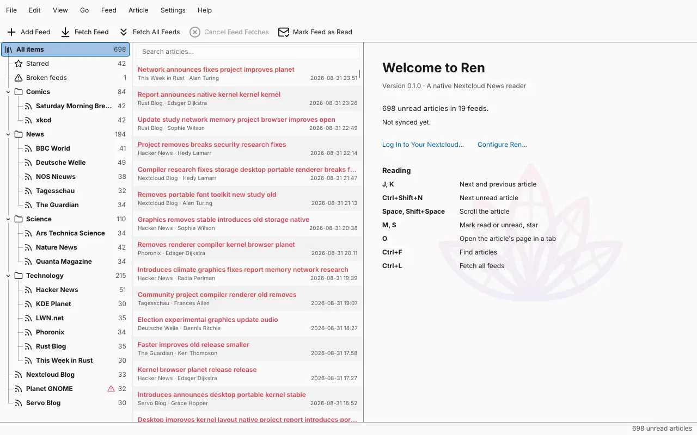
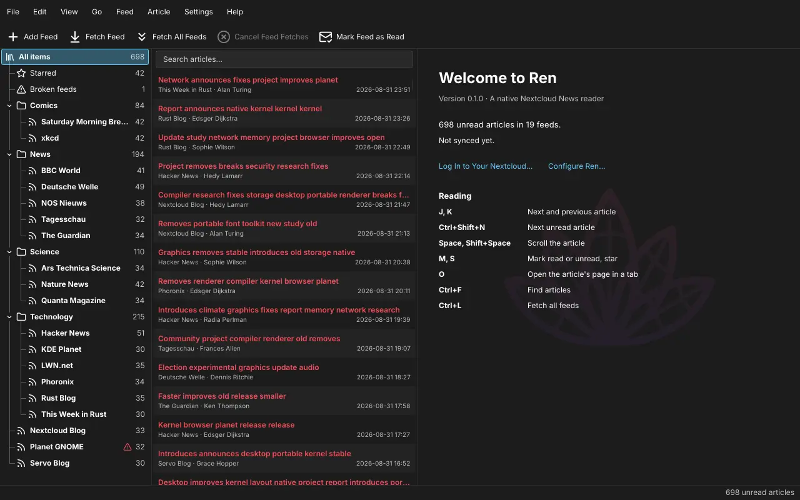
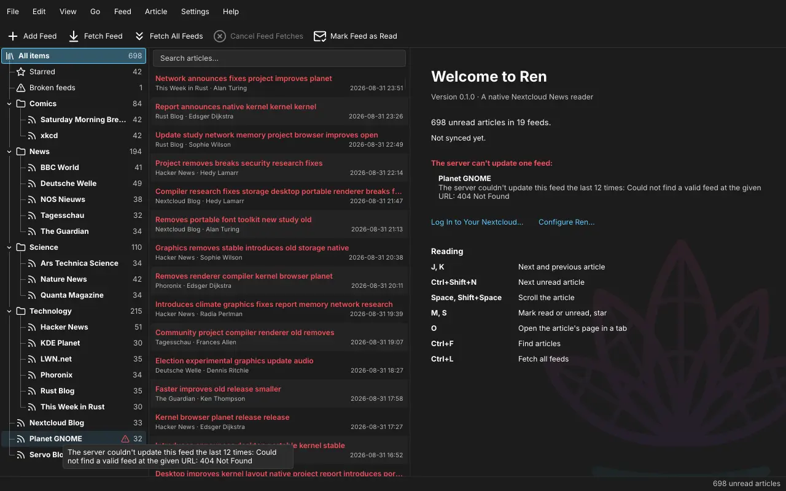
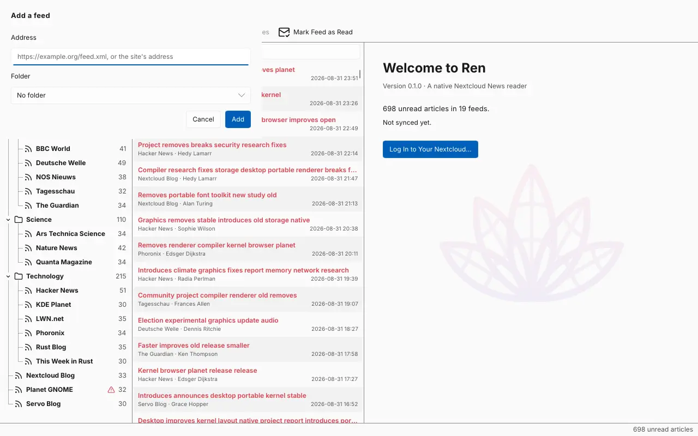
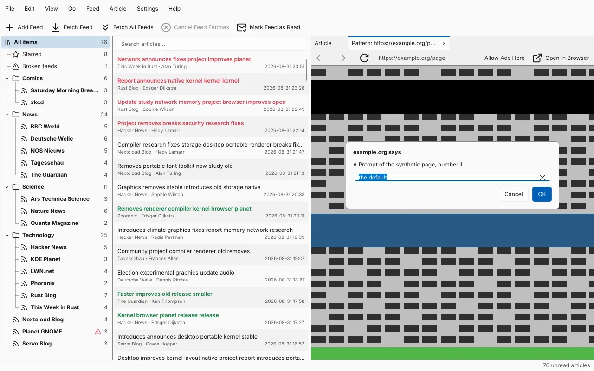
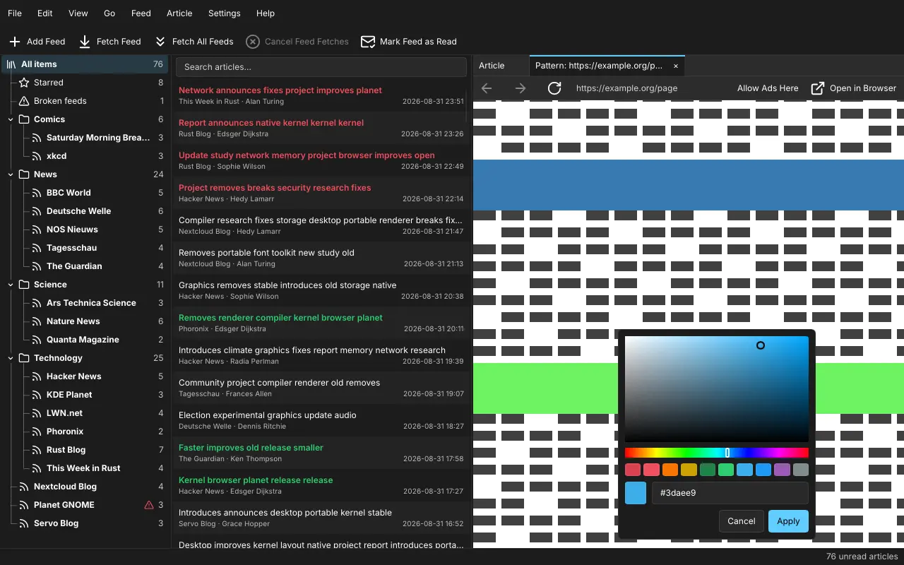

<!--
SPDX-FileCopyrightText: Copyright 2026  Heinz Wiesinger, Amsterdam, The Netherlands
SPDX-License-Identifier: GPL-3.0-or-later
-->

# 0017 — Features for the first release (M10b)

**Status:** done (2026-10-14), for review. Checked in the container
under Xvfb, the feed changes also against Nextcloud 32/News 28.7.0 and
33/29.0.0 in containers; not yet on the desktop (see "On the desktop").

## Context

The plan's M10b gathers what the first release needs beyond M10, in an
order where each item uses what the ones before made: "Ren" in what
users see, a logo (a wire-frame lotus, 蓮, *ren*) that is also M11's app
icon, the logo in the tray with a monochrome version, a welcome page,
one instance, broken feeds, adding feeds and fixing their URLs (with
renaming, moving and deleting feeds and folders), and the rest of
Servo's embedder controls, the largest item, to split off if it would
hold up the release.

## What was built

### "Ren"

Window titles, menus, dialogs, About Ren, the tray's tooltip and menu,
the account page's texts, the comment of a new settings file, the state
file's header and the label of the Secret Service entry say "Ren". Not
the executable, crate names, paths (`$XDG_*/ren`), ids (the Secret
Service's `service` attribute, the user agent `ren/0.1.0`, which
Nextcloud also shows as the app password's device), or the `ren:` prefix
on stderr. The `.desktop` file is M11's.

### The logo

A lotus of five petals drawn as outlines, each with its midrib and two
cross lines (the "wires"), in a gradient from pink to violet:
`crates/ren/icons/ren.svg`, for 48 pixels and up. At 16–32 pixels the
wires blur, so `ren-small.svg` is the lotus without them, and without
the parts of petals that others hide, so that the lines don't run
together where the petals meet; it's drawn on Breeze's 22-pixel grid,
with one-pixel lines like Breeze's icons. `ren-mono.svg` is that in one
colour. Under the GPL, like the code, with SPDX headers in the files.
The windows take the small one as their icon (X11; Wayland takes the
icon from the `.desktop` file, M11): window managers show it at title
bar size, where the wires ran together. About Ren shows the large one,
the welcome page has it as a faint background. M11 installs them into
the hicolor theme (scalable, and the small one at 16–32).

The review dropped the line of water in teal the logo first stood on
(too separate from the flower), and found the tray icon blurred next to
Plasma's own: the small logo had lines half again as thick as Breeze's,
which ran together into a blot where the five petals met, and was drawn
at 64 pixels for a panel showing 44 (see "The tray"). Both are fixed
above.

### The tray

The small logo replaces the feed icon on an orange square. A new
setting, `window.tray-icon-style` (Window), draws it in one colour
instead, like Plasma's symbolic tray icons:

- `colour` (default): the logo's colours, which show on light and dark
  panels;
- `monochrome`: light with a dark colour scheme, dark with a light one,
  updated when the scheme changes;
- `light`, `dark`: always light (for a dark panel) or dark.

Plasma recolours symbolic icons it loads by name from the icon theme;
Slint's tray sends pixels (`IconPixmap`), so Ren draws the colour
itself, Breeze's text colours (`#fcfcfc`, `#232629`). A panel's colours
can't be asked for: the colour scheme is the best guess, and the fixed
ones cover a panel that differs, as with Breeze Twilight (dark panel,
light windows).

Slint sends one pixmap, which the panel scales to its icon size. Plasma
shows tray icons at 22 pixels, so the icon is drawn at 44: that size at
a scale of 2, and halved cleanly at 1. At 64, as first, it was scaled by
1.45 or 2.9 and came out blurred.

### The welcome page

Shown in the article pane while no article is (at the start, after
choosing another list), as KDE's applications do: "Welcome to Ren", the
version, the unread articles and feeds, when the last sync ended and how
many articles it brought (or why the last one failed), links to log in
(without an account), fetch the feeds, add a feed and the settings, and
the shortcuts for reading, over the logo, faint, in the middle of the
pane. It listed the broken feeds with their errors too, which made it
too busy with a real account's 15 (the review); the tree has them.

The plan said "in the article view, so it costs nothing beyond what the
first article costs anyway". It's drawn by Slint in the article pane
instead: the article view (Blitz) is made with the first article, and
making it costs 16 MiB (0010), which a page at the start would pay before
any article is read. The texts come from `welcome.rs` (tested); the last
sync's time from the store (`Store::last_sync`, the key ren-sync writes),
the articles it brought from the "new" marker (`Store::new_count`).

### One instance

The window listens on a Unix socket, `$XDG_RUNTIME_DIR/ren/instance`. A
second start connects, sends `activate` with the launcher's activation
token (`XDG_ACTIVATION_TOKEN`, `DESKTOP_STARTUP_ID`), waits for `ok` and
exits; it never opens the database. The running window comes back from
the tray, or to the front: X11 raises and focuses it; on Wayland only the
launcher's token can, and winit 0.30 has no way to activate an existing
window with a token, so there the window asks for attention (the task
bar highlights it). A socket nobody answers on (a Ren that was killed)
is replaced; the socket goes when Ren quits, unless another Ren replaced
it meanwhile (its inode is compared).

A socket rather than a well-known name on the session bus: it needs no
D-Bus service of Ren's own, works without a session bus, and the code is
a hundred lines of the standard library (`instance.rs`, tested: the
hand-over, a socket left behind, requests). Without `$XDG_RUNTIME_DIR`
there is no socket, and a second start opens a second window as before.
Demo data (`--items`, `--dump`), another database (`--database`) and the
measurements stay apart (`Options::single_instance`).

*After the review (3b4fc64):* the socket is answered right after it is
claimed, not only once the window is made. Before, a start that handed
over while the first was still making its window (a cold start, a large
database) waited 2 s in vain and opened a second window; now it gets its
answer at once, and the window comes to the front once it exists.
Checked with two starts 50 ms apart: the second handed over in 8 ms.

### Broken feeds

The store has the server's `updateErrorCount` and `lastUpdateError` per
feed since M2. A feed counts as broken after more than eight failed
updates in a row (`Feed::is_broken`), the count the News web interface
marks feeds at: a site that is down for a while isn't broken yet.
Broken feeds get:

- a warning mark in the tree, with the error as its tooltip (Slint
  1.18's `Tooltip`), e.g. "The server couldn't update this feed the last
  12 times: Could not find a valid feed at the given URL: 404 Not
  Found";
- "Broken feeds" after "Starred" while there are any, with their number,
  which lists their articles (`Selection::Broken`; marked read item by
  item like "Starred", as the server can't mark such a list; kept in the
  state file).

The plan asked for the feed's last successful update "if the server
tells it": it doesn't. News' API v1-3 sends `nextUpdateTime` (when it
tries next), which isn't stored or shown. The demo data has one broken
feed now, for screenshots and the UI flows.

### Adding feeds, editing and deleting feeds and folders

`nextcloud-news` got the writes for feeds and folders (`Client::edit`,
`Edit`): `POST /feeds` (the server finds the feed, also from a site's
address, and fetches it; it answers with the feed), `POST
/feeds/{id}/rename` and `/move`, `DELETE /feeds/{id}`, `POST /folders`,
`PUT` and `DELETE /folders/{id}`. ren-sync's `change` sends a
`FeedChange`; the sync after it brings the result into the store, with
the articles of a feed added (their `lastModified` is after the cursor).

In the window: Feed → Add Feed (also the tool bar and the welcome page)
asks for the address and a folder, by default the one selected; a
feed's context menu edits it (name, address, folder), deletes it and
opens its homepage; a folder's renames and deletes it; the root's adds a
folder. Deleting asks first, in a window of its own: the articles go
with it, starred ones included, and that can't be undone.

The changes run on the sync thread, before a sync: they use its password
lookup (the Secret Service may block), run at its priority and never
next to a sync; asked for during a sync, they wait for its end. The
dialog stays open until the server answered and shows what it refused
(no feed at the address, one that exists already: 409); a feed added is
selected after the sync, and refusals stay in the status bar.

**Changing a feed's address:** the News API has none, so the dialog says
what a new address does: the feed at it is added in the old one's
folder, given the old one's name, and the old one is deleted, with its
articles, starred ones included. Only adding fails the change; a name
or a deletion that fails is reported as a warning ("delete it by hand").
Ren's own "Show Full Pages Instead of Articles" goes to the new feed.

**What the end-to-end test found** (extended to add, rename, move and
delete feeds and folders and change an address against Nextcloud): News
28.7 answers a new feed with `"unreadCount": null`, which the client
couldn't decode (null now counts as the default for the feed's counts
and flags); and deleting a folder through the API leaves its feeds
behind, pointing at the folder that's gone (with SQLite at least, which
the test's container uses), while the web interface deletes them. So Ren
deletes a folder's feeds first, then the folder, and says so before. Both
server versions pass.

### Servo's embedder controls

The helper dismissed everything but drop-downs and context menus (M8).
Now:

- **`alert`, `confirm`, `prompt`:** shown over the page, inside the page
  area and headed by the page's site ("example.org says"), so that a
  message the page wrote can't be taken for one of Ren's; Escape
  cancels, Enter confirms, a prompt's default is selected. Messages are
  cut to 2,000 characters. Servo blocks the page's script until the
  answer, as browsers do. *After the review (6433cdc):* a page's second
  dialog offers "Don't let this page show more dialogs"; its next ones
  are then cancelled without being shown, until the tab loads another
  page, so a script opening one after another can't keep the reader from
  the page (checked with `pattern-helper`).
- **Colour inputs:** Ren's colour picker from the settings dialog (now
  without "Theme's Colour"), below the element; clicking beside it keeps
  the page's colour.
- **File inputs** (uploads): the desktop's own file chooser through the
  XDG desktop portal (`org.freedesktop.portal.FileChooser.OpenFile`,
  which Plasma and GNOME provide), on a thread of its own, through the
  zbus already in the build; filtered by the extensions the page accepts
  (and "All files"), one or several files. A Slint dialog of Ren's own
  would be a file browser to write and maintain, and worse than the
  desktop's. Without a portal, the page gets no file and the status bar
  says why.
- **Input methods (IME)** are split off, to the backlog: Servo asks the
  embedder to show one where an editable element is and expects the
  composition as `ImeEvent`s, but Slint hands input methods only to its
  own `TextInput`, not to a `FocusScope`, so the page can't get what the
  input method composes. A hidden `TextInput` at the element that passes
  its committed text to the page might work, but needs a desktop with an
  input method to try. Typing without one is unaffected.

The protocol (`ren-tabs`) got `Event::Dialog`, `ColourPicker` and
`FilePicker` and their answers; `pattern-helper` opens them on keys (`a`,
`c`, `p`, `k`, `f`) and prints the answers, which tried the window's
side here: the answers arrived as given. The helper's side is checked
by CI's Servo job.

## Tests

New tests: the API's edits (requests, answers, the null count), ren-sync's
`change` on the fake server (adding, renaming, moving, deleting, a new
address and its failures), the end-to-end test's feed changes, the
sync thread's changes before a sync, the welcome page's texts, the
overview and broken feeds in the reader, the tree's "Broken feeds", the
tray icon's SVGs, one instance's socket, the portal's URIs and filters,
the helper's extensions and colours, and a UI flow that adds a feed (into
the folder selected) and deletes it against a mock server. `just
check-light` passes; the end-to-end test passes with Nextcloud 32/News
28.7.0 and 33/29.0.0 (`just test-nextcloud`, run here with the images
from `mirror.gcr.io`: Docker Hub refused the container's pulls).

## Cost

In the container under Xvfb, release builds without the engines
(`--no-default-features --features renderer-software,servo`), 10,000
generated items, RSS 5 s after the start, five runs each:

| | RSS | Event loop running |
|---|---|---|
| master (M10) | 33.4–34.0 MiB | 40–53 ms |
| M10b, welcome page shown | 35.6–36.3 MiB | 41–57 ms |
| M10b without the faint logo | 35.4–35.7 MiB | 39–57 ms |

So 2.2–2.6 MiB more at the start, of which the faint logo, drawn at the
pane's size, is about 0.6 MiB; the rest is the new code (the binary
grows by 1.1 MiB) and the welcome page's elements. The start is as fast
as before (within the runs' spread).

After the review the logo is drawn at 0.6 of the pane's smaller side
instead of 0.8, in the middle, and the broken feeds are gone from the
page. Measured again (five runs each, alternating): 34.2–35.6 MiB with
the logo, 34.4–35.0 MiB without, 38–62 and 41–46 ms; its cost is within
the runs' spread now. The feed dialog and the page's
dialogs are made when they open; the file chooser's thread and its
D-Bus connection last until it answers. On the desktop, `just measure`
compares the idle window again.

## On the desktop

Not checked there yet; worth a look before the release:

- the logo in the tray, in each style, on a light and a dark panel
  (`window.tray-icon-style`), and the window's icon on X11;
- starting Ren a second time, with the window behind others and hidden
  in the tray, on Wayland and X11;
- a page's file input (KDE's portal), a colour input, `alert`/`prompt`
  (e.g. on <https://www.w3schools.com/js/tryit.asp?filename=tryjs_prompt>);
- adding a feed by a site's address, and changing a feed's address, on
  the real server.

## Open

- Input methods in pages (see above), in the backlog.
- On Wayland a second start only highlights the running window in the
  task bar (winit can't activate a window with the launcher's token).
- The feed's last successful update isn't known to the API; Ren shows
  the errors only.
